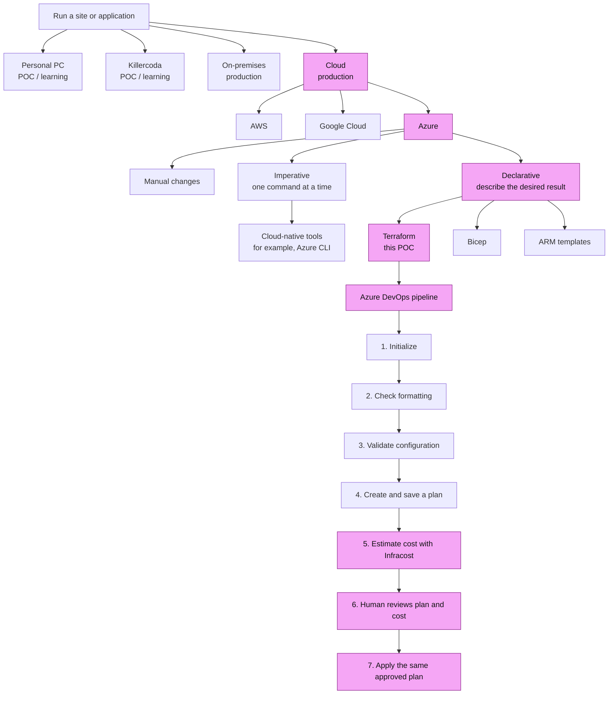

# Azure Infrastructure Cost and Deployment POC

This project shows, in a safe and understandable way, how a team can describe
Azure infrastructure as code, estimate its cost, ask a person to review it,
and only then make the approved change.

> **Important:** This is a learning POC, not a finished production landing
> zone. It currently creates one Azure resource group, which is a container
> for related Azure resources. Test it in a non-production subscription first.
> Replace every `REPLACE_*` value and configure the required Azure DevOps
> protections before use.

## What is in this project?

- **Terraform** describes the Azure resource that should exist.
- **Azure DevOps Pipelines** checks the description, creates a proposed
  change, and controls when it can be applied.
- **Infracost** estimates the proposed monthly infrastructure cost.
- **An approval gate** gives a person a chance to review the change and cost
  before Azure is changed.
- **Azure Blob Storage** keeps Terraform's state file, which is Terraform's
  record of the resources it manages.
- **OIDC sign-in** lets the pipeline sign in to Azure without storing a
  long-lived password or client secret in the repository.

## Architecture from the supplied diagram

The diagram distinguishes where an application runs, which cloud is selected,
and how infrastructure is described. The highlighted route is the route this
repository demonstrates. The other routes are choices in the diagram, not
deployments implemented by this POC.



### A few terms in plain language

- **POC** means *proof of concept*: a small experiment to learn whether an
  approach works.
- **Declarative** means describing the desired end result; Terraform works
  out which changes are needed to get there.
- **Imperative** means giving individual instructions, such as a sequence of
  CLI commands.
- **Plan** is Terraform's preview of what it intends to create, change, or
  remove. Reviewing a plan is like checking a shopping list before paying.
- **Apply** is the step that makes the approved plan real in Azure.
- **Cost estimate** is a forecast, not a bill. Actual charges can differ.

Terraform can work with multiple cloud providers, but **this repository is
currently an Azure example**. It does not configure AWS, Google Cloud,
on-premises infrastructure, manual deployments, Azure CLI deployments,
Bicep, or ARM templates.

## What the pipeline does

The pipeline in [`azure-pipelines.yml`](./azure-pipelines.yml) runs these
steps in order:

| Step | What it does | Why it matters |
| --- | --- | --- |
| 1. Initialize | Connects to the remote state and prepares Terraform using Azure OIDC. | Lets Terraform safely compare its record with Azure. |
| 2. Format | Checks that Terraform files use a consistent layout. | Makes changes easier for people to read. |
| 3. Validate | Checks Terraform configuration without changing Azure. | Finds configuration mistakes early. |
| 4. Plan | Creates a saved preview and a JSON copy for cost analysis. | Shows what Terraform intends to do. |
| 5. Estimate cost | Infracost estimates monthly cost and the policy script checks the configured cap. | Helps identify costs before deployment. |
| 6. Approve | A person reviews the saved plan and cost report. | Keeps a human decision before production changes. |
| 7. Apply | Applies the exact saved plan after approval. | Prevents applying a different plan from the one reviewed. |

If Terraform says the saved plan is stale, stop and create a new plan. Review
its cost and request approval again; do not silently create and apply a new
plan after approval.

## Versions

The tools are pinned so builds use known versions instead of silently
downloading whichever version happens to be newest. The following versions
were checked against their official release listings on **13 November 2026**:

| Component | Version used by this POC | Where it is set |
| --- | --- | --- |
| Terraform CLI | `1.17.2` | `terraformVersion` in `azure-pipelines.yml` |
| AzureRM Terraform provider | `5.13.0` | `infra/versions.tf` |
| Infracost CLI | `0.10.49` | `infracostVersion` in `azure-pipelines.yml` |
| Azure Pipelines hosted agent | `ubuntu-24.04` image | `pool.vmImage` in `azure-pipelines.yml` |
| Azure DevOps tasks | `AzureCLI@2`, `ManualValidation@1`, `PublishPipelineArtifact@1` | Task references in `azure-pipelines.yml` |

The hosted agent is a maintained image label, not a frozen operating-system
snapshot; Microsoft can update the software installed on it. Azure DevOps task
references use task major versions. Review release notes and run the pipeline
in a non-production environment before upgrading any component.

Official version sources:

- [Terraform releases](https://releases.hashicorp.com/terraform/)
- [AzureRM provider releases](https://github.com/hashicorp/terraform-provider-azurerm/releases)
- [Infracost releases](https://github.com/infracost/infracost/releases)
- [Microsoft-hosted Azure Pipelines agents](https://learn.microsoft.com/azure/devops/pipelines/agents/hosted)

After changing provider constraints, regenerate and commit the Terraform
dependency lock file (`infra/.terraform.lock.hcl`) so the pipeline can use
the selected provider reproducibly. Do not change versions directly in a
production pipeline without testing them first.

## Repository map

```text
Infracost-Azure-POC/
├── azure-pipelines.yml          # The checks, cost review, approval, and apply steps
├── infra/
│   ├── backend.tf               # Says Terraform state is stored in Azure Blob Storage
│   ├── main.tf                  # The Azure resource described by this POC
│   ├── outputs.tf               # Values Terraform prints after a successful apply
│   ├── providers.tf             # Azure provider setup
│   ├── terraform.tfvars.example # Example input values; copy and customize securely
│   ├── .terraform.lock.hcl      # Exact provider version and verified checksums
│   ├── variables.tf             # Inputs that can be changed for an environment
│   └── versions.tf              # Terraform and provider version requirements
├── policies/
│   └── cost-policy.json         # Currency and maximum estimated monthly cost
└── scripts/
    ├── cost-policy.py           # Fails the pipeline if cost cannot be checked or exceeds the cap
    └── install-tools.sh          # Downloads the pinned Terraform and Infracost versions
```

## Before running it

You need:

1. An Azure subscription for a **non-production** test.
2. An Azure DevOps project with permission to run pipelines.
3. An Azure Resource Manager service connection configured for **Workload
   Identity Federation (OIDC)**. The default pipeline placeholder is
   `REPLACE_WITH_AZURE_WIF_SERVICE_CONNECTION`.
4. An Azure Storage account and blob container for Terraform state.
5. An Infracost API key stored as a secret pipeline variable named
   `INFRACOST_API_KEY` (or in an appropriately secured variable group).
6. A Terraform dependency lock file committed at `infra/.terraform.lock.hcl`.

The pipeline also needs these values set to real values:

- `azureServiceConnection`
- `backendResourceGroup`
- `backendStorageAccount`
- `backendContainer`
- `backendKey`
- `productionEnvironment`
- The approver value in the `ManualValidation@1` task

Do not put credentials, API keys, or other secrets in Terraform files,
pipeline YAML, or committed variable files. The example
[`infra/terraform.tfvars.example`](./infra/terraform.tfvars.example) contains
only ordinary example settings; copy it to a local `.tfvars` file if needed
and keep that file out of Git.

## Azure and pipeline safety setup

Before any real deployment:

- Use OIDC instead of a stored client secret.
- Give the pipeline identity only the Azure permissions it needs.
- Give the identity the required `Storage Blob Data Contributor` access to
  the state container; do not grant broad subscription access just for
  convenience.
- Protect the state storage account with appropriate access controls,
  recovery/versioning, monitoring, and network restrictions.
- Create the Azure DevOps Environment `terraform-production` and configure
  approvals/checks outside this YAML, such as an approver group, branch
  restrictions, and an exclusive lock.
- Protect the `main` branch and restrict who can change the pipeline or its
  service connection.
- Keep plan artifacts private and limit their retention: plan files can
  contain sensitive values.
- Do not expose production credentials, state, or plan artifacts to
  untrusted pull-request builds. This pipeline deliberately sets `pr: none`;
  use a separate, credential-free PR validation pipeline.

The YAML manual approval is an extra checkpoint, not a substitute for Azure
DevOps Environment approvals and checks.

## Cost policy

The example [`policies/cost-policy.json`](./policies/cost-policy.json) sets
a maximum estimated monthly cost of **USD 500**. Change this to a value
approved by the people responsible for the budget before using the pipeline.
The policy script fails closed: if the cost report is missing or has an
unexpected structure, the pipeline fails instead of treating the cost as
zero.

This example checks the estimated total against a maximum; it does not yet
compare the change against a trusted baseline or enforce a percentage-change
limit. For a cost-difference check, create a trusted baseline from the
protected default branch and use the matching Infracost CLI's documented
diff workflow. Do not use a baseline supplied by an untrusted pull request.

Infracost estimates can differ from the final bill because of actual usage,
discounts, reservations, taxes, data transfer, and other billing details.
Use Azure Cost Management budgets and alerts as additional safeguards.

## Safe local checks

From the repository folder, these checks do not deploy resources:

```bash
terraform -chdir=infra fmt -check -recursive
terraform -chdir=infra init -backend=false
terraform -chdir=infra validate
```

To try the full pipeline, first confirm the service connection, backend,
permissions, lock file, secret variable, cost limit, approver, and protected
Azure DevOps Environment are all configured. Review the first plan and cost
report carefully, and apply only in the non-production subscription.

## Troubleshooting

| Problem | What to check |
| --- | --- |
| Terraform cannot initialize the backend | Check the storage account, container, state key, OIDC setup, and Blob Data Contributor permission. |
| Azure sign-in or deployment fails | Check the service connection, subscription, and the minimum Azure permissions required by the resources. |
| Pipeline reports a missing lock file | Generate `infra/.terraform.lock.hcl` with the selected Terraform/provider versions, review it, and commit it. |
| Infracost cannot create a report | Check the secret API key, network access, pinned CLI version, and saved plan JSON. |
| Cost policy cannot read the report | Inspect the JSON produced by the pinned Infracost version; update the parser deliberately rather than weakening the fail-closed check. |
| Terraform says the saved plan is stale | Stop, create a new plan, review the new cost report, and request approval again. |
# Infracost-Azure-POC

# Infracost-Azure-POC

# Infracost-Azure-POC

# Infracost-Azure-POC

